# Official Espejo de Agua imagery

Cataloged 50 unique image URLs across the official homepage, gallery, emergency appeal, and Techo, Camino y Semilla project page. Downloaded 12 selected originals into `assets/espejo-de-agua/originals`. Retrieval date: 2026-11-07T20:59:41.690105+00:00.

[Full provenance catalog](./image-catalog.json) records source URLs, pages, captions, checksums, dimensions, and intended use. Originals are preserved unchanged. Only the reviewed logo and two photos are copied/optimized under `public/espejo-de-agua`; WebP copies retain the whole frame and omit embedded metadata.

## Placement

The homepage archive section credits Espejo de Agua and links each image to its original source page. The roof photo keeps its Ibanacuara earthquake context, and the workshop keeps its Mariela context. These photos are never used as fictional project covers, donation material images, or verified delivery evidence. Other downloaded photos remain available for future organization or original-event sections.

## Rights and attribution

Source-site imagery; no explicit open reuse license was found on the parsed pages. Attribution is recorded, not a license grant. Preserve the publisher attribution and original context when reusing these files.

## Refresh

Run from the repository root with dependencies installed:

```sh
python3 scripts/import-espejo-images.py
node scripts/prepare-espejo-images.mjs
```

The importer is limited to four named pages and twelve selected images on the official domain. It records other discovered images without downloading them.

## Downloaded gallery

### logo-header.png


80 × 80 · 10 KiB · [Source image](https://www.espejodeagua.org/assets/img/logo-header.png) · [Source page](https://www.espejodeagua.org/)

Organization attribution; preserve the original logo. Shown on the homepage from `public/espejo-de-agua/logo.png`.

### patty-teatro-barranquilla.jpg

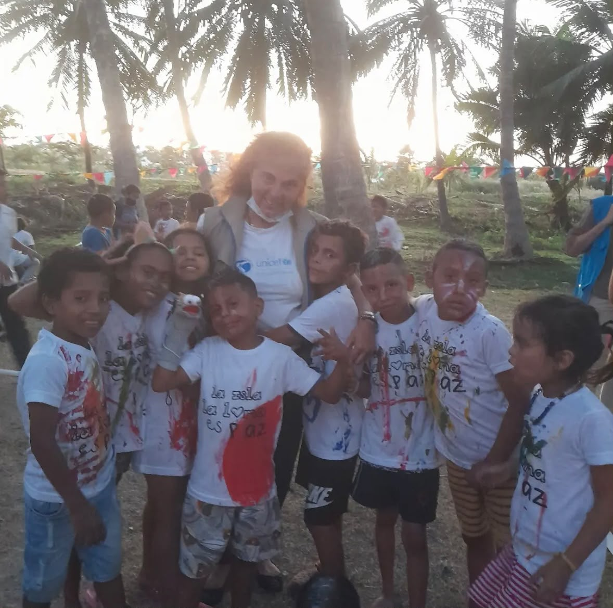

1178 × 1169 · 172 KiB · [Source image](https://www.espejodeagua.org/assets/img/patty-teatro-barranquilla.jpg) · [Source page](https://www.espejodeagua.org/)

Organization arts-work section; Barranquilla workshop. Downloaded for future contextual use; not exposed by the app.

### patty-valores-padres-campesinos-mariela.jpg

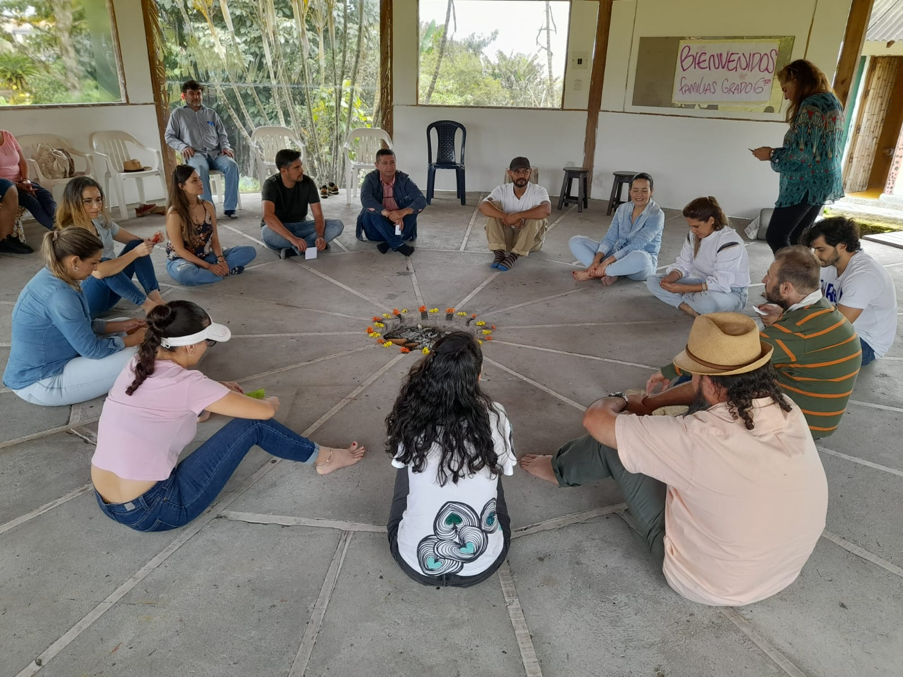

1600 × 1200 · 272 KiB · [Source image](https://www.espejodeagua.org/assets/img/patty-valores-padres-campesinos-mariela.jpg) · [Source page](https://www.espejodeagua.org/)

Organization community-work section; Mariela workshop. Shown on the homepage from `public/espejo-de-agua/mariela-workshop.webp`.

### convergencia-vital.jpg

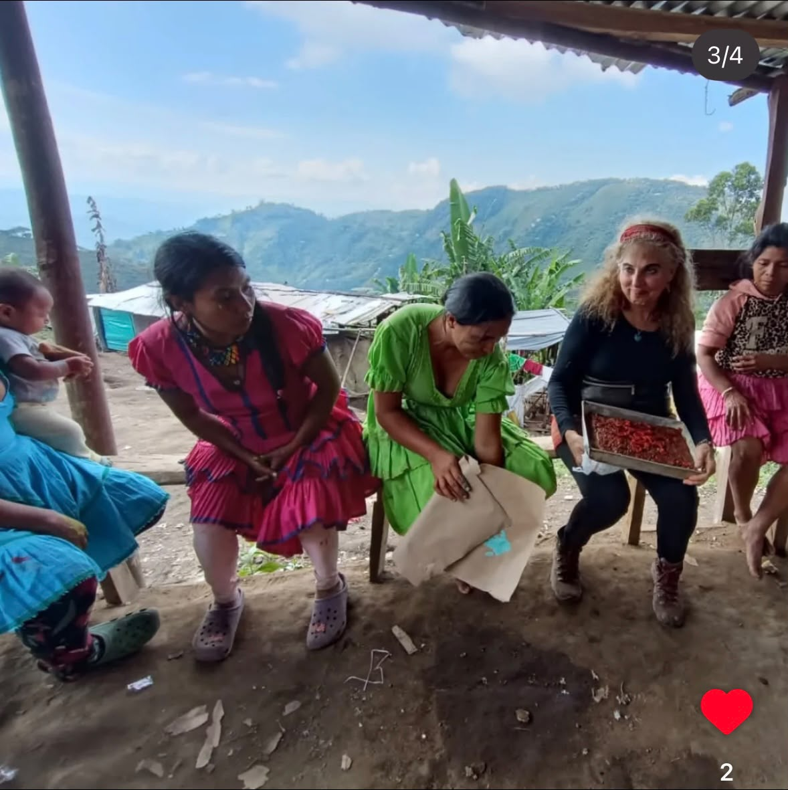

1178 × 1181 · 147 KiB · [Source image](https://www.espejodeagua.org/assets/img/convergencia-vital.jpg) · [Source page](https://www.espejodeagua.org/)

Organization community-work section; Convergencia Vital. Downloaded for future contextual use; not exposed by the app.

### terremoto-grietas.jpg

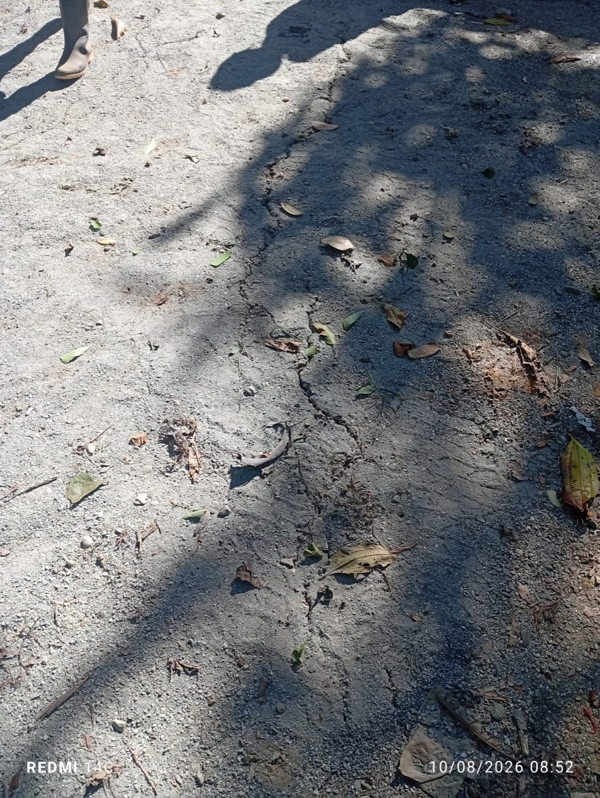

1053 × 1400 · 504 KiB · [Source image](https://www.espejodeagua.org/assets/img/terremoto-grietas.jpg) · [Source page](https://www.espejodeagua.org/galeria.html)

Earthquake ground damage; original event context only. Downloaded for future contextual use; not exposed by the app.

### terremoto-camino.jpg

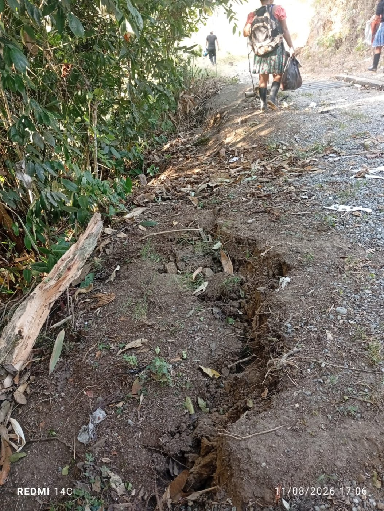

1053 × 1400 · 478 KiB · [Source image](https://www.espejodeagua.org/assets/img/terremoto-camino.jpg) · [Source page](https://www.espejodeagua.org/galeria.html)

Earthquake-damaged access route; original event context only. Downloaded for future contextual use; not exposed by the app.

### resguardo-ibanacuara-condiciones.jpg

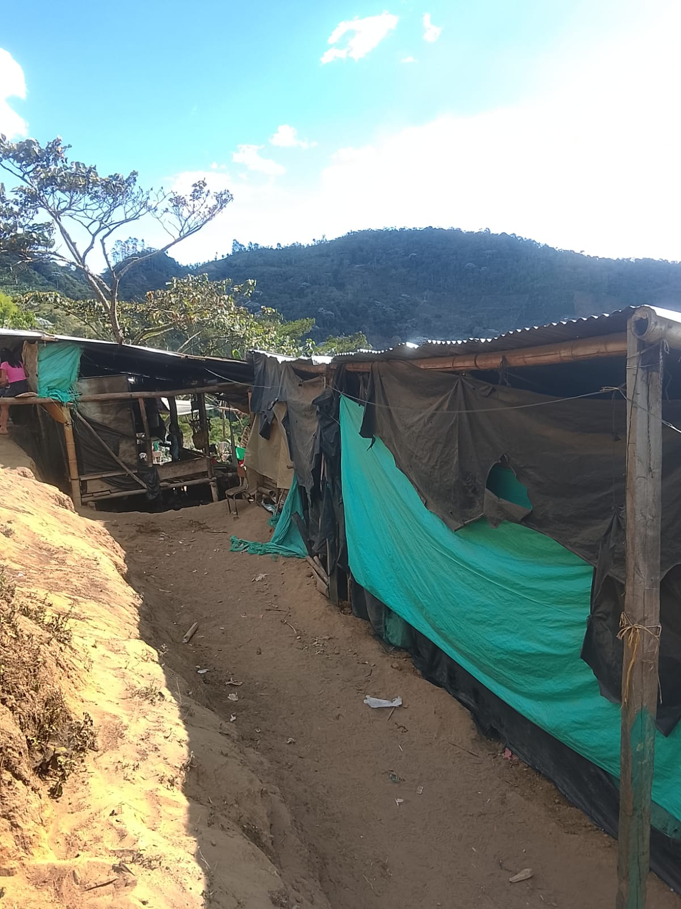

1200 × 1600 · 238 KiB · [Source image](https://www.espejodeagua.org/assets/img/resguardo-ibanacuara-condiciones.jpg) · [Source page](https://www.espejodeagua.org/galeria.html)

Temporary shelter context; Ibanacuara only. Downloaded for future contextual use; not exposed by the app.

### resguardo-ibanacuara-condiciones2.jpg

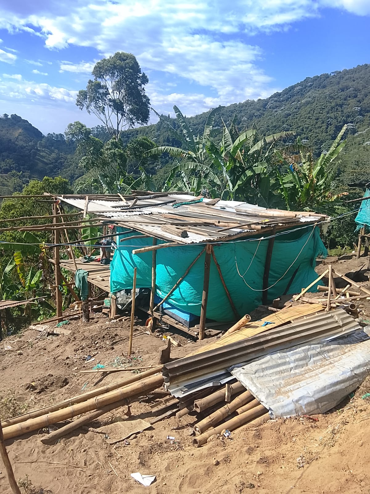

1200 × 1600 · 417 KiB · [Source image](https://www.espejodeagua.org/assets/img/resguardo-ibanacuara-condiciones2.jpg) · [Source page](https://www.espejodeagua.org/galeria.html)

Damaged housing context; Ibanacuara only. Downloaded for future contextual use; not exposed by the app.

### resguardo-ibanacuara-condiciones4.jpg

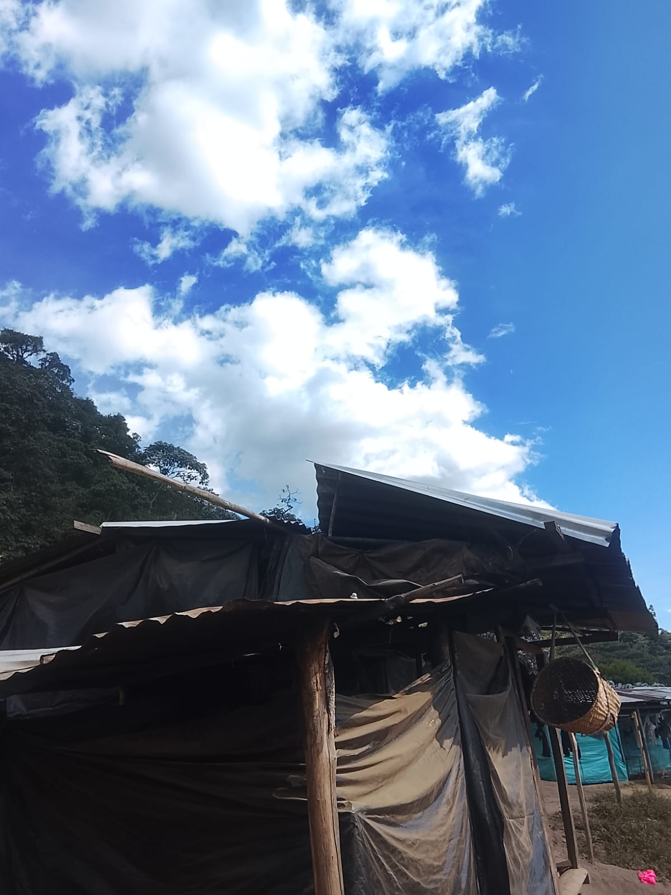

1200 × 1600 · 152 KiB · [Source image](https://www.espejodeagua.org/assets/img/resguardo-ibanacuara-condiciones4.jpg) · [Source page](https://www.espejodeagua.org/galeria.html)

Temporary shelter context; Ibanacuara only. Downloaded for future contextual use; not exposed by the app.

### resguardo-ibanacuara-condiciones5.jpg

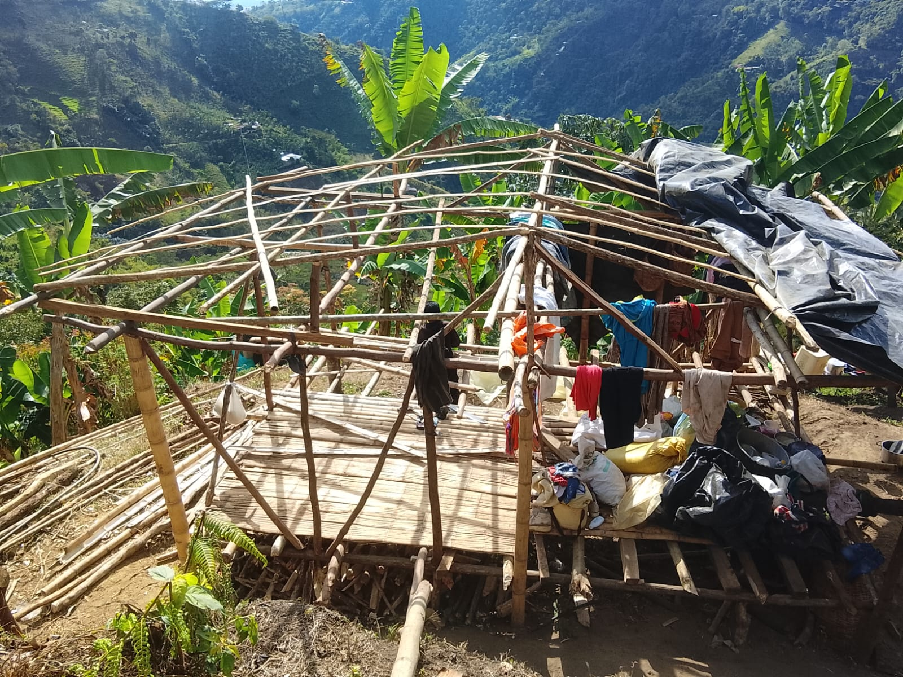

1600 × 1200 · 414 KiB · [Source image](https://www.espejodeagua.org/assets/img/resguardo-ibanacuara-condiciones5.jpg) · [Source page](https://www.espejodeagua.org/galeria.html)

Roof damage context; Ibanacuara only. Shown on the homepage from `public/espejo-de-agua/ibanacuara-roof.webp`.

### resguardo-ibanacuara-condiciones6.jpg

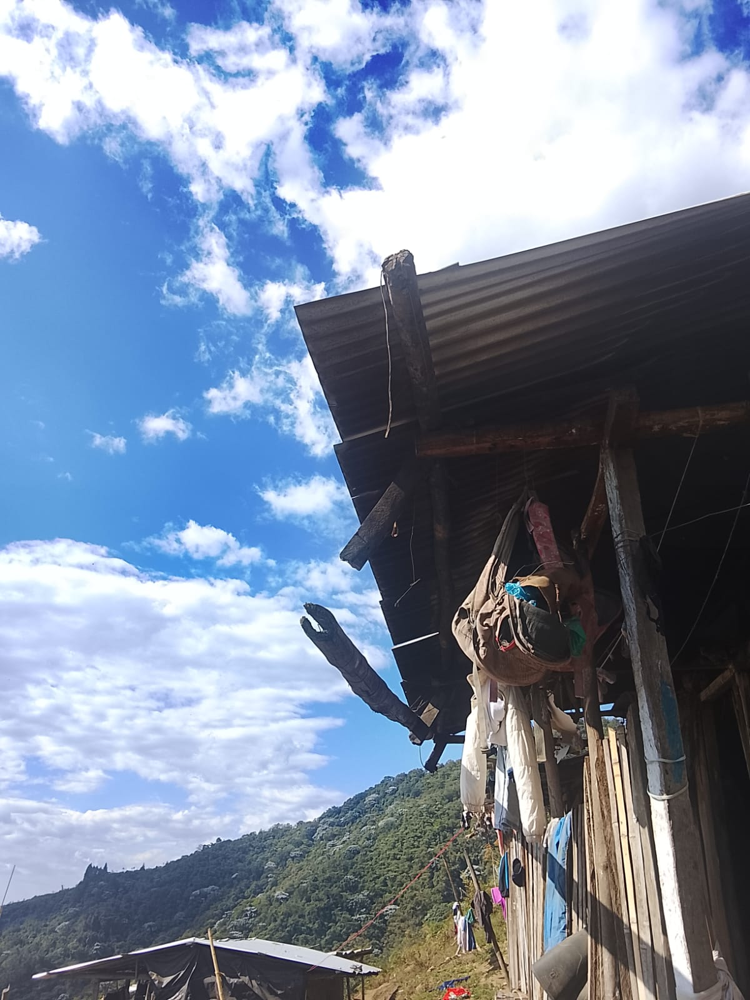

1200 × 1600 · 197 KiB · [Source image](https://www.espejodeagua.org/assets/img/resguardo-ibanacuara-condiciones6.jpg) · [Source page](https://www.espejodeagua.org/galeria.html)

Roof damage context; Ibanacuara only. Downloaded for future contextual use; not exposed by the app.

### resguardo-ibanacuara-condiciones7.jpg

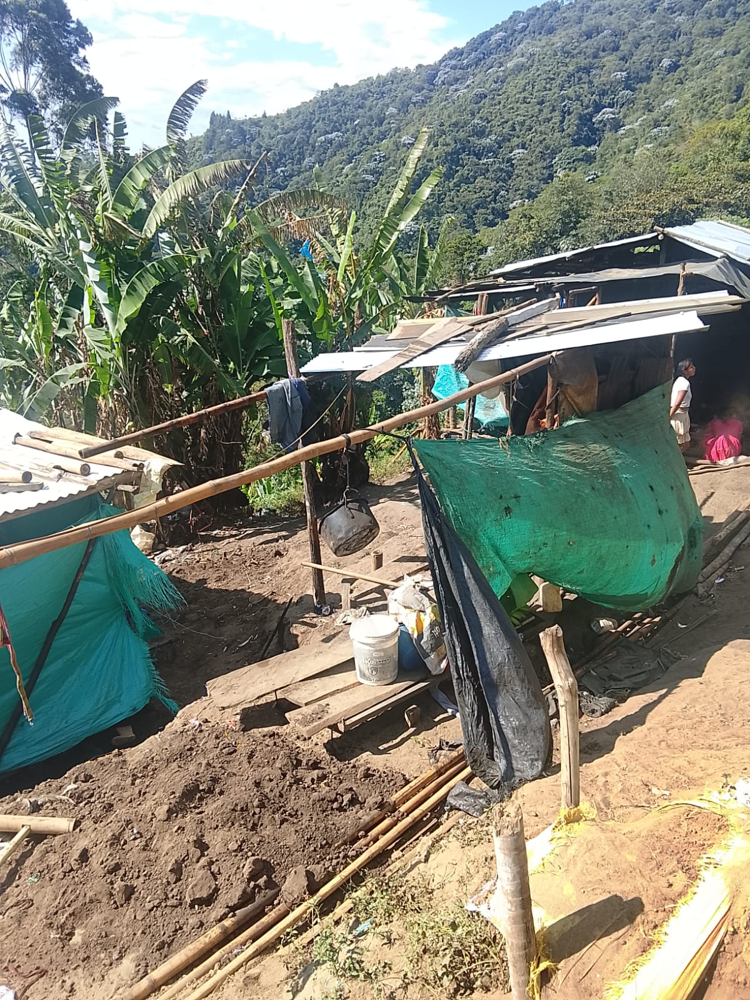

1200 × 1600 · 454 KiB · [Source image](https://www.espejodeagua.org/assets/img/resguardo-ibanacuara-condiciones7.jpg) · [Source page](https://www.espejodeagua.org/galeria.html)

Camp context; Ibanacuara only. Downloaded for future contextual use; not exposed by the app.
