# Donation and program illustrations

Generated with the built-in ImageGen tool on November 7, 2026. These are decorative illustrations, not photographs of beneficiaries or evidence of delivery, construction, or verified impact. Approved project cover photos take precedence; evidence and photo galleries continue to use their original uploaded files.

All 15 assets are 640 × 640 WebP images, about 637 KiB combined. They use a pale paper background, navy details, and warm natural material tones. Next.js serves responsive optimized sizes for the local illustrations. Browser-ready project cover URLs are rendered directly.

The complete generation prompt for each image is in [illustration-prompts.json](./illustration-prompts.json). Original PNGs were preserved in the local ImageGen output directory; the optimized, self-contained website deliverables are under `public/materials` and `public/brand`.

## Materials

| Bricks | Cement | Roofing sheets |
| --- | --- | --- |
| 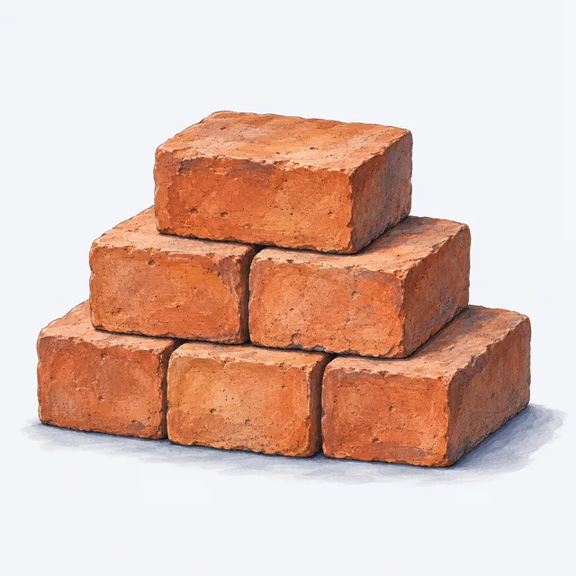 | 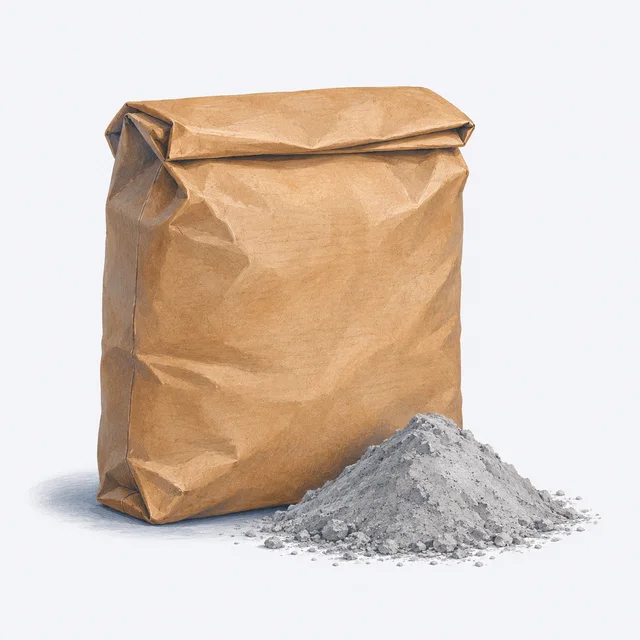 | 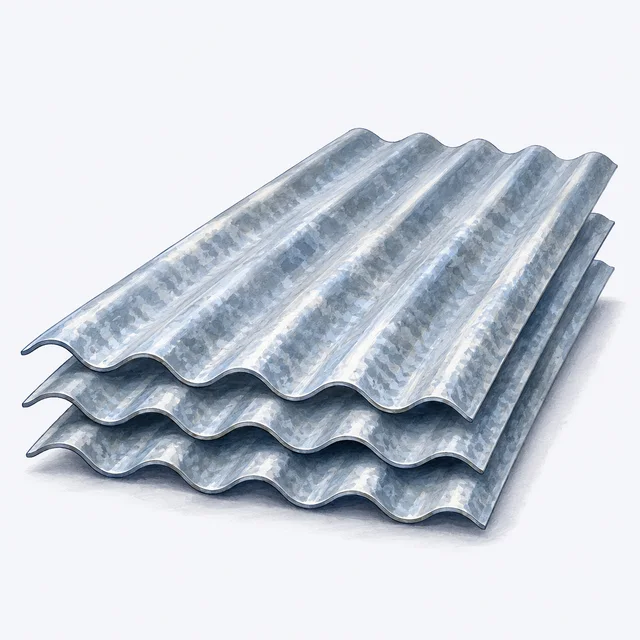 |

| Timber | Nails | Tarp |
| --- | --- | --- |
| 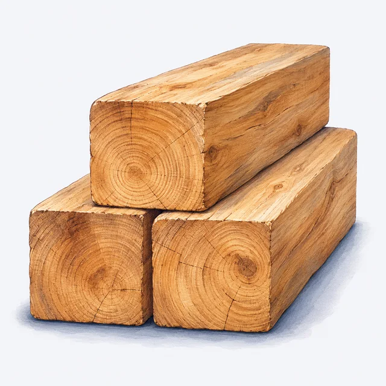 |  | 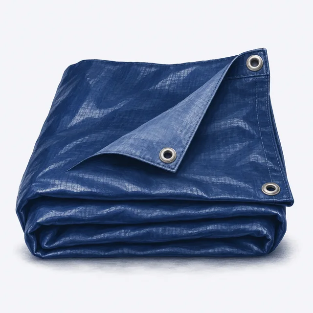 |

| Paint | Rebar | Seeds |
| --- | --- | --- |
| 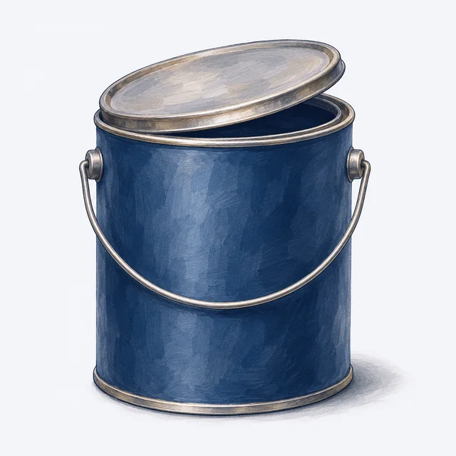 | 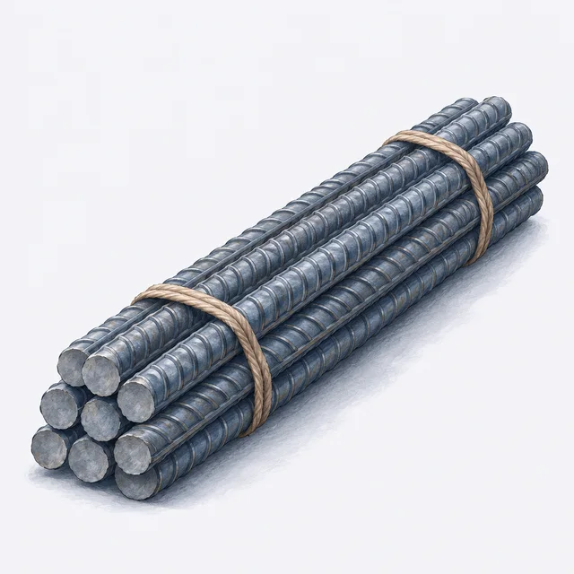 | 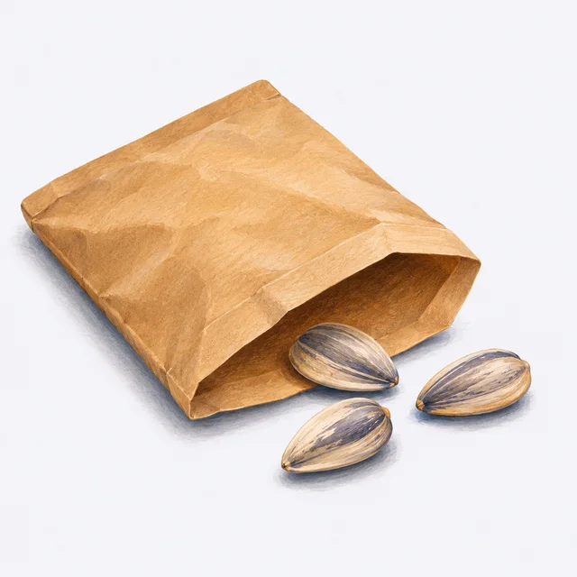 |

| Soil | Water tank | Tools |
| --- | --- | --- |
| 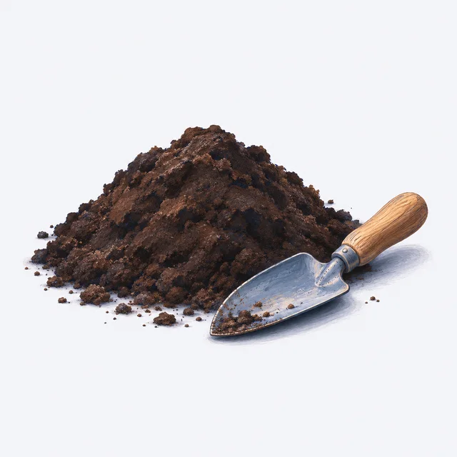 | 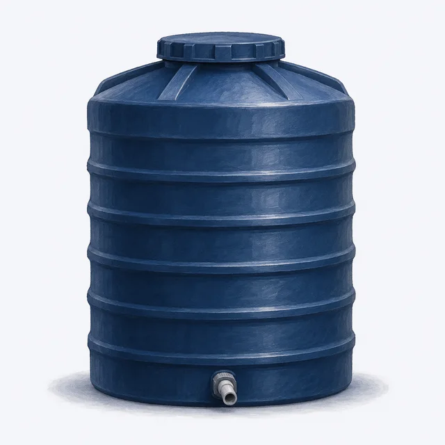 | 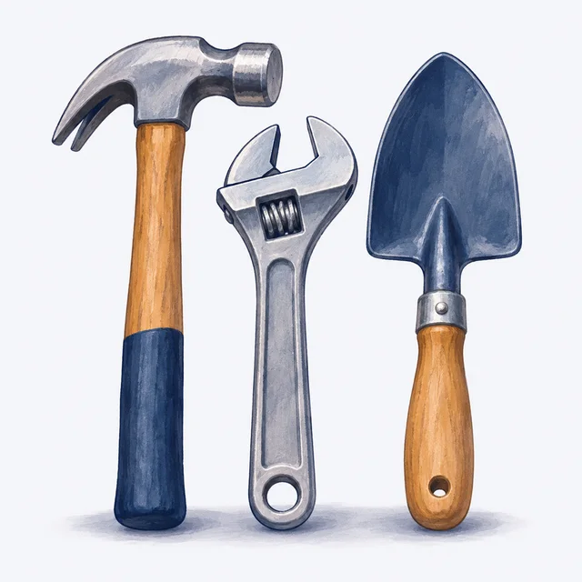 |

## Programs

| Shelter | Reconstruction | Healing and growing |
| --- | --- | --- |
| 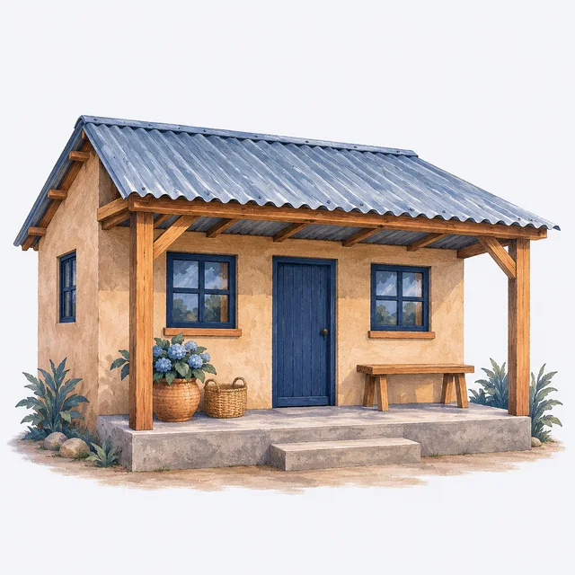 | 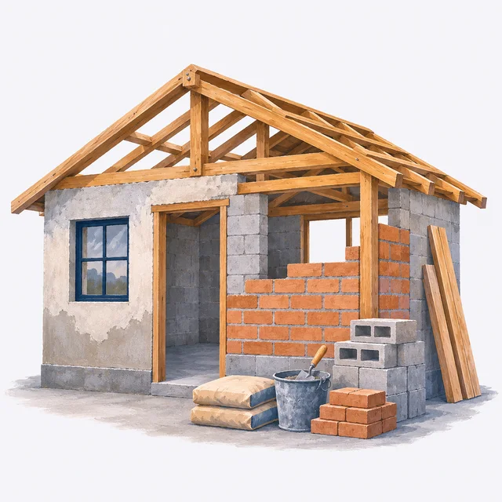 | 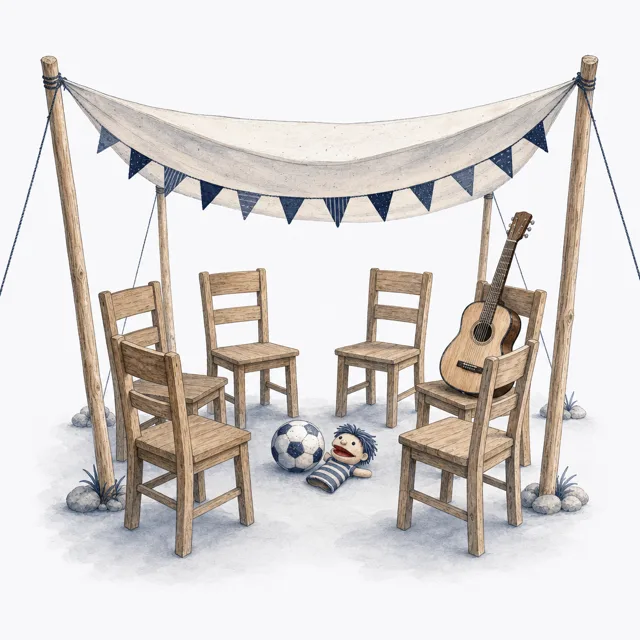 |

## Integration

- Donation swipe cards and contribution dialogs display material artwork.
- Project needs, My Donations, and pledge tracking reuse the same material images through `MaterialImage`.
- Homepage program panels, project listing thumbnails, and project mastheads use program illustrations when an approved cover is unavailable.
- Unknown material keys and failed asset loads retain the existing SVG glyphs. A failed cover first tries its program illustration.
- Images beside existing labels have empty alternative text to avoid duplicate announcements. Dragging images is disabled so donation-card swipe gestures still work.
- Internal coordinator controls keep their compact line icons.
